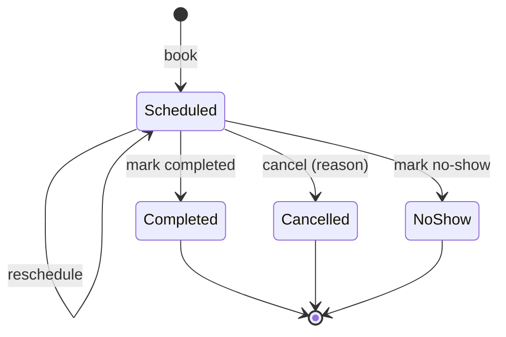
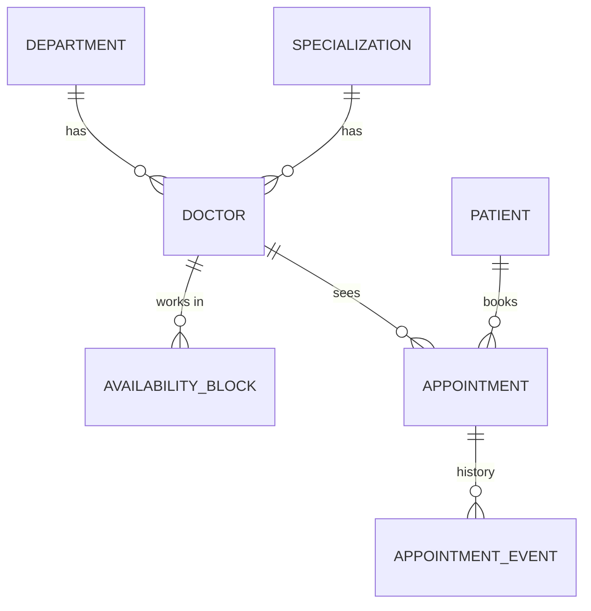

# Hospital Management System: MVP product requirements

| | |
| --- | --- |
| Product | Hospital Management System (HMS), test product for the AI Skill Library |
| Owner | Puneet Singh Nanda |
| Status | Reviewed; open questions decided (§10) |
| Data | Invented data only. No real patients, doctors or contact details, anywhere |

## 1. Purpose

A small hospital front desk needs one place to keep its doctors, its patients and their appointments, and to see
the day at a glance. This MVP covers exactly that.

It also has a second job: six engineers will extend it together using the AI Skill Library workflows. The MVP
must therefore be a clean, conventional base that new features can be added to without rework: clear layers,
SQL migrations, tests, and one shared environment where the merged result runs.

## 2. Goals and non-goals

**Goals**

| Id | Goal |
| --- | --- |
| G-1 | Staff can manage doctors, patients and appointments end to end from the web app. |
| G-2 | Booking rules prevent double-booking and appointments outside a doctor's availability. |
| G-3 | The dashboard shows today's workload and appointment outcomes in one screen. |
| G-4 | Adding sign-in and roles later changes configuration and one middleware, not every screen or route. |
| G-5 | Every merge to `main` is deployed to the shared test environment, so the team sees the integrated system. |

**Non-goals for the MVP**

- Sign-in, roles and permissions (the architecture is ready for them; see §4.6).
- Billing and payments, prescriptions, lab results, wards and beds, inventory, insurance.
- Notifications (SMS, email), patient self-service, telemedicine.
- More than one hospital or branch.
- Full electronic health records. "Basic medical history" is a short structured summary (§4.2).

## 3. Users

During the MVP there is no sign-in, so everyone uses the app as **staff**. The roles below shape the design and
become real when authentication arrives.

| Role (later) | Uses the MVP to |
| --- | --- |
| Receptionist | Register patients, book, reschedule and cancel appointments |
| Doctor | See their own schedule, mark appointments completed |
| Administrator | Manage doctors, departments and availability |

## 4. Features

### 4.1 Doctor management (DOC)

**Fields**

| Field | Rules |
| --- | --- |
| Doctor ID | System-generated, read-only, format `D-0001` |
| Full name | Required, 2–100 characters |
| Specialization | Required, one Active entry from the specializations list (§4.5), e.g. Cardiology, Dermatology, General Medicine |
| Department | Required, one Active entry from the departments list (§4.5) |
| Phone | Required, digits with optional leading `+`, 8–15 digits |
| Email | Optional, valid email format |
| Consultation fee | Required, ≥ 0, in Indian rupees (INR). Stored as integer paise; shown as ₹ with two decimals |
| Slot length | Required, minutes, one of 10, 15, 20, 30, 45, 60. Default 15 |
| Availability | Weekly schedule: one or more blocks of day-of-week + start time + end time (e.g. Mon 09:00–13:00). Blocks for the same day must not overlap |
| Status | Active or Inactive. Default Active |

**Requirements**

| Id | Requirement |
| --- | --- |
| DOC-1 | Staff can create a doctor with the fields above. Invalid fields are rejected with a message per field. |
| DOC-2 | Staff can list doctors, 20 per page, sorted by name, and filter by department, specialization and status. Search matches name or doctor ID. |
| DOC-3 | Staff can view a doctor's details, weekly availability and upcoming appointments. |
| DOC-4 | Staff can edit any field except the doctor ID. |
| DOC-5 | A doctor with any appointments cannot be deleted; staff set them Inactive instead. A doctor with no appointments can be deleted. |
| DOC-6 | An Inactive doctor cannot receive new bookings. Their existing scheduled appointments stay and are listed so staff can reschedule or cancel them. |
| DOC-7 | Changing availability does not move or cancel existing appointments. Appointments that fall outside the new availability are flagged on the doctor page. |

### 4.2 Patient management (PAT)

**Fields**

| Field | Rules |
| --- | --- |
| Patient ID | System-generated, read-only, format `P-000001` |
| Full name | Required, 2–100 characters |
| Date of birth | Required, a past date, not more than 120 years ago. Age is shown, not stored |
| Gender | Required: Female, Male, Other, Prefer not to say |
| Phone | Required, same format as doctors |
| Email | Optional, valid email format |
| Address | Optional, free text, up to 300 characters |
| Emergency contact | Optional: name and phone |
| Blood group | Optional: A+, A−, B+, B−, AB+, AB−, O+, O−, Unknown |
| Allergies | Optional, list of short text items |
| Chronic conditions | Optional, list of short text items |
| Current medications | Optional, list of short text items |
| Medical notes | Optional, free text, up to 2,000 characters |
| Status | Active or Inactive. Default Active |

**Requirements**

| Id | Requirement |
| --- | --- |
| PAT-1 | Staff can register a patient with the fields above. Invalid fields are rejected with a message per field. |
| PAT-2 | Staff can list patients, 20 per page, newest registration first. Search matches name, patient ID or phone. |
| PAT-3 | Staff can view a patient's details, medical history and appointments (upcoming first, then past). |
| PAT-4 | Staff can edit any field except the patient ID. |
| PAT-5 | Registering a patient whose name, date of birth and phone all match an existing patient shows a warning with a link to that patient. Staff can still continue. |
| PAT-6 | A patient with any appointments cannot be deleted; staff set them Inactive instead. A patient with no appointments can be deleted. |
| PAT-7 | An Inactive patient cannot be booked. |
| PAT-8 | Medical history is shown only on the patient's own page, never in lists, the dashboard or logs. |

### 4.3 Appointment management (APT)

**Fields**

| Field | Rules |
| --- | --- |
| Appointment ID | System-generated, read-only, format `A-000001` |
| Doctor | Required, an Active doctor |
| Patient | Required, an Active patient |
| Start | Required: date and start time. The end is start + the doctor's slot length at booking time |
| Reason for visit | Optional, up to 300 characters |
| Status | Scheduled, Completed, Cancelled, No-show |
| Cancellation reason | Required when cancelling, up to 300 characters |

**Status flow**



**Requirements**

| Id | Requirement |
| --- | --- |
| APT-1 | Staff can book an appointment by choosing a doctor, a date and one of the free slots shown for that day. |
| APT-2 | A slot is free only if it lies inside the doctor's availability for that weekday, is in the future, and does not overlap another Scheduled appointment of the same doctor. |
| APT-3 | A patient cannot have two Scheduled appointments that overlap in time, with any doctors. |
| APT-4 | Booking is safe under concurrency: if two people book the same slot at once, exactly one succeeds and the other sees "slot no longer available". |
| APT-5 | Staff can reschedule a Scheduled appointment to another free slot of the same doctor. The appointment keeps its ID; the previous time is kept in its history. |
| APT-6 | Staff can cancel a Scheduled appointment with a reason. A cancelled slot becomes free again. |
| APT-7 | Staff can mark a Scheduled appointment Completed or No-show, but only once its start time has passed. |
| APT-8 | Completed, Cancelled and No-show appointments cannot be changed. |
| APT-9 | Staff can list appointments for one doctor or one patient, filtered by date range and status, 20 per page, ordered by start time. |
| APT-10 | Staff can view a day's schedule for one doctor, showing booked and free slots. |
| APT-11 | Every change to an appointment (booked, rescheduled, cancelled, completed, no-show) is recorded with the time and the actor, and shown as the appointment's history. |

### 4.4 Dashboard (DSH)

All counts are computed live from the database. "Today" means the current calendar day in the hospital's time
zone (§7).

| Id | Tile | Definition |
| --- | --- | --- |
| DSH-1 | Total patients | Number of Active patients |
| DSH-2 | Total doctors | Number of Active doctors |
| DSH-3 | Appointments today | Appointments starting today, any status except Cancelled |
| DSH-4 | Upcoming appointments | Scheduled appointments starting after now. The dashboard also lists the next 10, with time, doctor and patient name |
| DSH-5 | Completed appointments | Completed appointments in the selected period |
| DSH-6 | Cancelled appointments | Cancelled appointments in the selected period |

| Id | Requirement |
| --- | --- |
| DSH-7 | The period for DSH-5 and DSH-6 is Today, Last 7 days or Last 30 days. Default Today. |
| DSH-8 | Each tile links to the list it counts (e.g. Cancelled → appointment list filtered to Cancelled in the period). |
| DSH-9 | The dashboard shows no medical history and no contact details. |

### 4.5 Departments and specializations (REF)

Both are short lists that staff maintain. The MVP seeds a starting set (e.g. departments: Outpatient, Emergency,
Surgery, Paediatrics; specializations: General Medicine, Cardiology, Dermatology, Orthopaedics, Paediatrics).

| Field | Rules |
| --- | --- |
| Name | Required, 2–60 characters, unique within its list (case-insensitive) |
| Status | Active or Inactive. Default Active |

| Id | Requirement |
| --- | --- |
| REF-1 | Staff can list, add and rename departments and specializations. |
| REF-2 | An entry used by any doctor cannot be deleted; staff set it Inactive instead. An unused entry can be deleted. |
| REF-3 | Inactive entries cannot be chosen for a doctor. Doctors who already have them keep them, and the doctor page shows the entry as Inactive. |
| REF-4 | Renaming an entry changes it everywhere it is shown, including existing doctors. |

### 4.6 Sign-in and access control (AUTH): deferred

Not built in the MVP. The architecture keeps it a contained change:

| Id | Requirement |
| --- | --- |
| AUTH-1 | Every API request passes through one identity middleware. In the MVP it sets the actor to `staff` without checking anything. |
| AUTH-2 | Routes declare the permission they need (e.g. `appointments:write`). In the MVP every permission is granted; later the middleware checks the actor's roles. |
| AUTH-3 | Records carry `created_at`, `created_by`, `updated_at`, `updated_by`, filled from the actor. |
| AUTH-4 | When sign-in is added it uses the organisation's identity provider (OIDC). The app never stores passwords. |
| AUTH-5 | Because the MVP has no sign-in, the shared test URL is open to anyone who has it. It holds invented data only. |

## 5. Data model



- One SQL migration file per change in `db/migrations/`, named with a UTC timestamp
  (`20261016T103000__create_doctors.sql`) so that six engineers adding migrations in parallel never collide.
- Times are stored in UTC (`timestamptz`); availability blocks store local wall-clock times plus the weekday.
- Money is stored as integers in the smallest currency unit.
- The database enforces what it can: foreign keys, `CHECK` constraints on enums and ranges, and an exclusion
  constraint so two Scheduled appointments of one doctor can never overlap (backs APT-4).

## 6. API

JSON over HTTP under `/api`. Validation errors return `400` with one message per field; a conflict (slot taken,
appointment no longer Scheduled) returns `409`; unknown IDs return `404`. Lists return `items`, `page`,
`page_size` and `total`.

| Area | Endpoints |
| --- | --- |
| Doctors | `GET/POST /api/doctors`, `GET/PATCH/DELETE /api/doctors/:id`, `PUT /api/doctors/:id/availability`, `GET /api/doctors/:id/slots?date=` |
| Patients | `GET/POST /api/patients`, `GET/PATCH/DELETE /api/patients/:id` |
| Appointments | `GET/POST /api/appointments`, `GET /api/appointments/:id`, `POST /api/appointments/:id/reschedule`, `POST /api/appointments/:id/cancel`, `POST /api/appointments/:id/complete`, `POST /api/appointments/:id/no-show` |
| Dashboard | `GET /api/dashboard?period=today\|7d\|30d` |
| Departments | `GET/POST /api/departments`, `PATCH/DELETE /api/departments/:id` |
| Specializations | `GET/POST /api/specializations`, `PATCH/DELETE /api/specializations/:id` |
| Health | `GET /api/health` |

## 7. Non-functional requirements

| Id | Requirement |
| --- | --- |
| NFR-1 | Stack: Node.js 22, Express and TypeScript API; React web app; PostgreSQL 16; Vitest. Layers: routes → services → repositories. |
| NFR-2 | The hospital time zone is `Asia/Kolkata` (configurable). All "today" and slot calculations use it. Currency is INR. |
| NFR-3 | List and dashboard requests answer within 500 ms with 10,000 patients and 50,000 appointments. |
| NFR-4 | Every requirement ID above has at least one automated test that names it. Database tests run against a throwaway PostgreSQL, never the shared database. |
| NFR-5 | No secrets in git. The database URL comes from the `DATABASE_URL` environment variable (Render settings, or a git-ignored `.env` on a laptop). |
| NFR-6 | Logs never contain medical history, contact details or full request bodies. |
| NFR-7 | Seed data is invented: made-up names, `example.com` emails, and phone numbers from a reserved test range. |
| NFR-8 | The web app works on current Chrome and Edge, at 1280 px and wider, with keyboard navigation and labelled form fields. |

## 8. Environments and team workflow

```
engineers ──AI Skill Library runs──▶ tsl/<ticket> branches ──draft PRs──▶ main
                                                                │ auto-deploy (migrate, then start)
own Neon database branch (dev) ◀── reset from main ──┐          ▼
                                                     └── Neon "hms" main ◀── Render "hms-test" (shared URL)
```

- **Shared test environment:** a Render web service deployed from `main`. On each deploy it applies new
  migrations, then starts. Its database is the `main` branch of a dedicated Neon project, separate from every
  other system.
- **Developer databases:** each engineer has their own Neon database branch, created from `main`, for local
  runs. It can be reset from `main` at any time.
- **Changes** arrive as pull requests from AI Skill Library runs and are merged by a reviewer. A merge is the
  only way code reaches the shared environment.

## 9. Acceptance

The MVP is accepted when:

1. Every requirement in §4 has a passing automated test that names its ID (NFR-4).
2. On the shared environment, a reviewer can, using seed data only:
   - create a doctor with availability, and a patient;
   - book, reschedule, cancel and complete appointments;
   - see each action reflected in the dashboard tiles.
3. Booking the same slot from two browsers at once leaves exactly one appointment (APT-4).
4. The AI Skill Library context pack builds and signs cleanly against the MVP code.

## 10. Decisions

| Id | Question | Decision |
| --- | --- | --- |
| OQ-1 | Currency and hospital time zone | INR and `Asia/Kolkata` |
| OQ-2 | No-show status | In the MVP (APT-7): a past appointment the patient missed is closed as No-show instead of staying Scheduled |
| OQ-3 | Restrict the shared test URL before sign-in exists | No. The URL stays open; invented data only (AUTH-5) |
| OQ-4 | Departments and specializations | Staff can maintain both lists (§4.5) |

Features beyond this PRD are added on top of the MVP through AI Skill Library runs, one ticket at a time.
